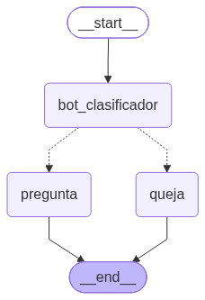
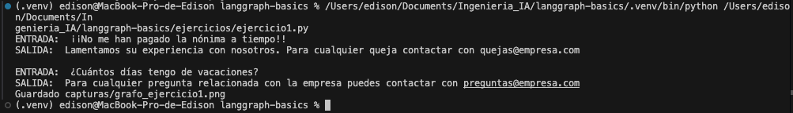
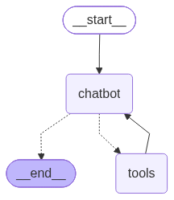
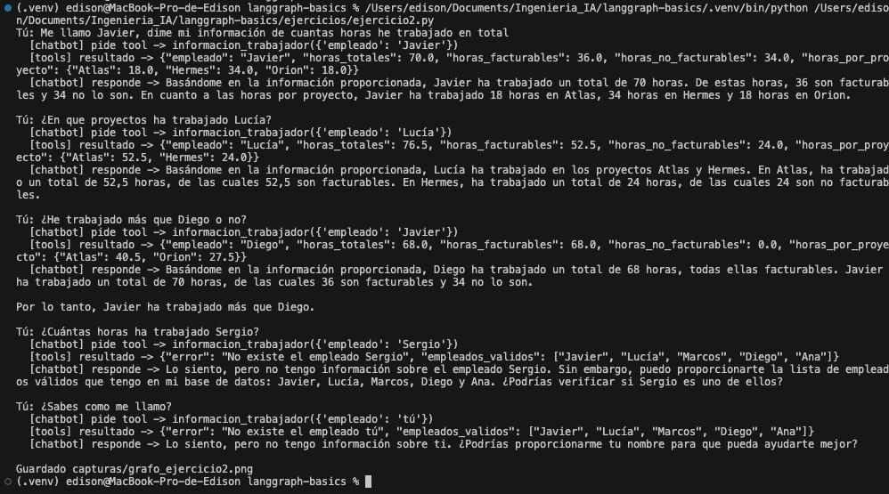

# langgraph-basics · Master AI Engineer · Sesion 2

Proyecto de clase: de un grafo minimo a un agente con memoria y herramientas, un paso por archivo.
Incluye mis soluciones a los ejercicios para casa en `ejercicios/`.
Todo corre en local con Ollama (llama3.1): coste de API 0 EUR.

## Puesta en marcha
1. Ollama con el modelo descargado (de la Sesion 1): `ollama pull llama3.1`
2. Crea el entorno: `python -m venv .venv` y activalo:
   - macOS / Linux: `source .venv/bin/activate`
   - Windows: `.venv\Scripts\activate`
3. Instala dependencias: `pip install -r requirements.txt` (langgraph, langchain-core, langchain-ollama, pandas)

**Ejecuta todos los scripts desde la raiz del proyecto** (`python ejercicios/ejercicio1.py`, no desde dentro de `ejercicios/`): los ejercicios guardan los diagramas en `capturas/` con rutas relativas.

## Estructura
```
langgraph-basics/
├── 01_grafo_simple.py ... 05_grafo_final.py   # pasos vistos en clase
├── extras/                                    # variaciones vistas en clase
├── ejercicios/
│   ├── ejercicio1.py                          # mi solucion al Ejercicio 1
│   └── ejercicio2.py                          # mi solucion al Ejercicio 2
├── soluciones/                                # solucion de referencia del Ejercicio 1
├── capturas/                                  # grafos y ejecuciones de mis ejercicios
├── datos.csv                                  # datos para la tool del Ejercicio 2
├── PROMPTS.md                                 # prompts usados en la practica
└── requirements.txt
```

## Los conceptos
- **State**: un TypedDict que viaja por todo el grafo. Es la memoria compartida: si no esta en el State, el grafo no lo sabe.
- **Nodos**: funciones que leen el State y devuelven SOLO las claves que cambian.
- **Aristas (edges)**: que nodo va despues de cual. Las **condicionales** eligen el camino segun el State y permiten ciclos.
- **Checkpointer**: guarda el State despues de cada paso, por `thread_id`. Da memoria entre turnos.

## Los pasos
| Archivo | Que demuestra |
|---|---|
| `01_grafo_simple.py` | State + 2 nodos + edges; compilar, invocar y dibujar el grafo |
| `02_chatbot.py` | State con `add_messages` y un nodo que llama a ChatOllama |
| `03_memoria.py` | `MemorySaver` + `thread_id`: recuerda entre turnos |
| `04_herramientas.py` | `ToolNode` + `tools_condition`: el ciclo chatbot -> tools -> chatbot |
| `05_grafo_final.py` | Dibuja el grafo final en `grafo.png` |

Ejecuta cada uno con `python <archivo>`.

## Extras (variaciones vistas en clase)
- `extras/paso1_stream.py` · ver el State despues de cada nodo con `stream`
- `extras/paso2_sin_reducer.py` · que pasa si quitas `add_messages`
- `extras/paso3_checkpoints.py` · el checkpointer guarda una foto en cada paso
- `extras/paso4_sin_tool.py` · la arista condicional decide: con y sin tool

## Ejercicios para casa

### Ejercicio 1 · Un grafo que clasifica y responde
**Enunciado:** clasifica un mensaje como pregunta o queja y una arista condicional lo manda a un nodo de respuesta u otro.

**Mi solucion:** `python ejercicios/ejercicio1.py`

- `bot_clasificador` (nodo): el LLM clasifica el mensaje y guarda la etiqueta ya limpia (`strip().lower()`) en `tipo_pregunta`.
- `decidir_siguiente` (funcion de la arista condicional, no es un nodo): lee `tipo_pregunta` y devuelve el nombre del siguiente nodo.
- `pregunta` / `queja` (nodos): responden con un `AIMessage` distinto segun la rama.
- El State usa `add_messages` para guardar la conversacion como lista de mensajes.

**Grafo** · las lineas discontinuas son la arista condicional que sale de `bot_clasificador`:



**Ejecucion** · un mensaje de cada tipo, y cada uno sale por su rama:



Solucion de referencia: `soluciones/ejercicio1_clasificador.py`.

### Ejercicio 2 · El grafo por fases, con una tool propia
**Enunciado:** grafo simple -> chatbot -> memoria -> herramientas, con tu propia tool, y una conversacion multi-turno que la use.

**Mi solucion:** `python ejercicios/ejercicio2.py`

Agente de proyectos que consulta un registro de horas (`datos.csv`: fecha, proyecto, empleado, rol, tarea, horas, facturable).

- **Tool `informacion_trabajador(empleado)`**: filtra el CSV con pandas y devuelve horas totales, facturables, no facturables y desglose por proyecto. Si el empleado no existe, devuelve un `error` con la lista de empleados validos para que el modelo pueda corregirse.
- **Memoria**: `MemorySaver` + `thread_id`.
- **Conversacion de prueba**:
  - `cliente1`: el usuario dice su nombre, pregunta por otra empleada y despues se compara con un tercero. El turno 3 solo funciona si el modelo recuerda quien es "yo" (memoria + tool juntas).
  - `cliente2`: pregunta por un empleado que no existe (caso de error) y comprueba que este hilo no comparte memoria con `cliente1`.

**Grafo** · el ciclo `chatbot -> tools -> chatbot`; `tools_condition` decide si ir a `tools` o terminar:



**Ejecucion:**



Que se ve en la ejecucion:
- **Turnos 1 y 2**: el modelo llama a la tool con el empleado correcto y redacta la respuesta con las cifras que devuelve pandas.
- **Turno 3** ("¿He trabajado mas que Diego?"): el modelo recuerda que el usuario es Javier y pide **dos llamadas a la tool en paralelo**, una para Javier y otra para Diego. La funcion `conversar` solo imprime la primera llamada (`tool_calls[0]`) y el ultimo resultado (`messages[-1]`), por eso en pantalla aparece la llamada de Javier junto al resultado de Diego. La conclusion (70 h > 68 h) es correcta.
- **Turno 4** (`cliente2`, "Sergio"): la tool devuelve el `error` con los empleados validos y el modelo se lo explica al usuario.
- **Turno 5** (`cliente2`, "¿Sabes como me llamo?"): el modelo no sabe el nombre porque `cliente2` no comparte memoria con `cliente1`. Aun asi, llama a la tool con `'tú'` sin necesidad: es un fallo de criterio del modelo, y la tool lo gestiona devolviendo el error.

**Observaciones:**
- Los calculos los hace pandas dentro de la tool; el LLM solo redacta la respuesta.
- llama3.1 (8B) lee bien las cifras, pero a veces se equivoca al compararlas (en otra ejecucion dijo que 70 era mayor que 76,5). Para comparaciones fiables habria que hacerlas en una tool.

## Notas
- La primera llamada tarda mas: Ollama carga el modelo en memoria.
- `draw_mermaid_png` usa el servicio web mermaid.ink; si tarda, los scripts reintentan hasta 5 veces.
- Poca RAM (<8 GB)? Usa `llama3.2:3b` y cambia el nombre del modelo en los scripts.
